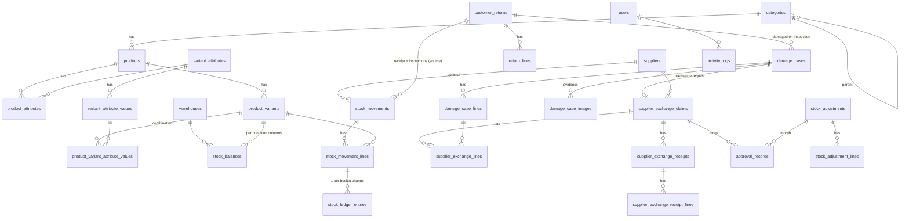

# StockPilot — Quantity-Only Inventory Management System

## 1. Requirements Analysis

**Scope.** Track *quantities* of product variants across stock conditions, with full auditability.
No prices, costs, revenue, invoices or accounting anywhere in the system.

### Core business rules

| # | Rule |
|---|------|
| R1 | A product has 0..n attributes (Size, Color, Fabric …). Attributes and their values are data, never code. |
| R2 | Only explicitly selected attribute combinations become variants (sparse matrix — L/Red may exist while L/Black does not). |
| R3 | A variant combination is unique per product (`product_id + combination_key`) and every variant has a globally unique SKU. |
| R4 | A product with no attributes still owns exactly one *default* variant so that stock is always variant-level. |
| R5 | Stock is held per **variant × warehouse × condition**. Conditions: `available`, `inspection`, `damaged`, `with_supplier`. |
| R6 | Physical on-hand = available + inspection + damaged. `with_supplier` is tracked but is **not** physical stock. |
| R7 | Balances are never edited directly. Every change is a posted movement that writes immutable ledger entries. |
| R8 | No bucket may go negative; checks run under row locks inside one DB transaction. |
| R9 | A form submission carries an idempotency token — a replayed/double-clicked submit never posts twice. |
| R10 | Customer returns enter `inspection`. Inspection moves units to `available` (good) or `damaged` (bad). Partial inspections allowed; inspected qty can never exceed returned qty. |
| R11 | Damage removes units from `available` immediately (→ `damaged`), so they can't be stocked out. |
| R12 | Supplier exchange approvals **never** change stock. Dispatch moves `damaged → with_supplier`; receipt removes `with_supplier` and adds `available` (replacement variant may differ). |
| R13 | Stock adjustments (count differences) require approval by a different user than the requester. |
| R14 | Business dates/reporting use `Asia/Dhaka`; timestamps are stored in UTC. |
| R15 | Every create/review/approve/dispatch/receive action records the acting user. |

### MVP

Products & dynamic variants · Stock IN / OUT / Opening · Returns + inspection · Damage + supplier exchange workflow ·
Suppliers · Adjustments with approval · Dashboard · 10 reports with CSV/XLSX/PDF export · Roles & permissions ·
Notifications · Activity log · Ledger reconciliation · CSV import · Global search.
Multi-warehouse is *modelled* (every balance/movement has `warehouse_id`) with one default warehouse in the UI;
barcode support is prepared by unique SKU + nullable `barcode` column on variants.

## 2. Architecture

```
app/
  Enums/                 StockCondition, MovementType, ClaimStatus, …
  Models/                Eloquent models (thin: relations, casts, scopes)
  Services/Inventory/    InventoryPoster  ← the ONLY writer of balances/ledger
                         MovementLineData (DTO), InsufficientStockException
  Services/              ReturnService, DamageService, ExchangeClaimService,
                         AdjustmentService, VariantBuilder, ReportService,
                         DashboardService, ActivityLogger, ReconciliationService
  Http/Controllers/      Thin controllers → Form Requests → Services
  Http/Requests/         Validation for every write
  Policies/              Object-level rules (e.g. cannot approve own adjustment)
  Notifications/         LowStock, ClaimAwaitingAction, AdjustmentAwaitingApproval
resources/js/
  layouts/ components/   App shell, sidebar, data-table, stat cards, charts
  pages/                 One Inertia page per screen
```

**Posting pipeline (all stock-changing actions):**

```
Controller → FormRequest → DomainService
      └─ DB::transaction
           ├─ idempotency check (unique key on stock_movements)
           ├─ ensure balance rows exist (insertOrIgnore)
           ├─ SELECT … FOR UPDATE balance rows (ordered by id → no deadlocks)
           ├─ apply signed deltas per condition, reject negatives
           ├─ insert stock_movements + stock_movement_lines
           ├─ insert stock_ledger_entries (signed delta + balance_after)
           └─ domain document updates (return/claim/adjustment status)
```

## 3. Database ER Diagram



Key constraints

* `product_variants`: unique `sku`; unique `(product_id, combination_key)` where `combination_key` = sorted attribute-value ids.
* `product_variant_attribute_values`: unique `(product_variant_id, variant_attribute_id)` — one value per axis.
* `stock_balances`: unique `(product_variant_id, warehouse_id)`; unsigned integer columns `available, inspection, damaged, with_supplier`.
* `stock_movements`: unique `reference_no`, unique `idempotency_key`; `source_type/source_id` links to the business document.
* `stock_ledger_entries`: insert-only; index `(product_variant_id, warehouse_id, condition, business_date)`.
* All quantities are integers; all FKs restrict deletion of anything referenced by history.

## 4. Inventory Flow

| Action | Movement type | Bucket deltas | Physical effect |
|---|---|---|---|
| Opening stock | `opening` | available + | IN |
| Stock IN | `stock_in` | available + | IN |
| Stock OUT | `stock_out` | available − | OUT |
| Return received | `return_receipt` | inspection + | IN (return) |
| Inspection: good | `return_inspection` | inspection −, available + | internal (0) |
| Inspection: damaged | `return_inspection` | inspection −, damaged + | internal (0) |
| Damage recorded | `damage` | available −, damaged + | internal (0) |
| Supplier dispatch | `supplier_dispatch` | damaged −, with_supplier + | OUT (to supplier) |
| Replacement received | `supplier_receipt` | with_supplier − (orig. variant), available + (replacement) | IN (from supplier) |
| Claim short-closed | `supplier_write_off` | with_supplier − | none (already out) |
| Adjustment (approved) | `adjustment` | ± chosen condition | ± |

Internal condition transfers net to zero on physical stock and are excluded from IN/OUT totals — no double counting.

**Exchange claim state machine**

```
pending_review → reviewed → supplier_agreed → approved → dispatched → partially_received → closed
        └──────────┴──────────────┴→ rejected (damaged stock stays in `damaged`)
```

## 5. Roadmap

1. Foundation — Laravel 13 / Inertia 3 / React 19, MySQL, roles & permissions, design system.
2. Inventory — attributes, categories, products, variant matrix builder, posting engine, Stock IN/OUT/Opening, movements.
3. Operations — returns & inspection, damage, suppliers, exchange claims & approvals, adjustments.
4. Analytics — dashboard, reports & exports, low-stock alerts, notifications, activity log, reconciliation, import, search.
5. Quality — Pest feature tests for every stock workflow, concurrency/idempotency tests, reconciliation checks.
